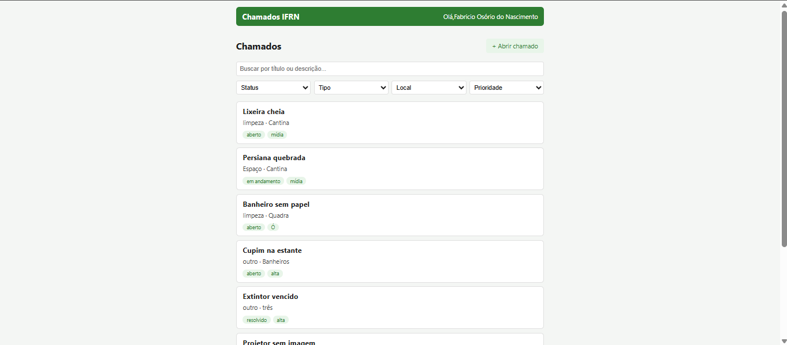
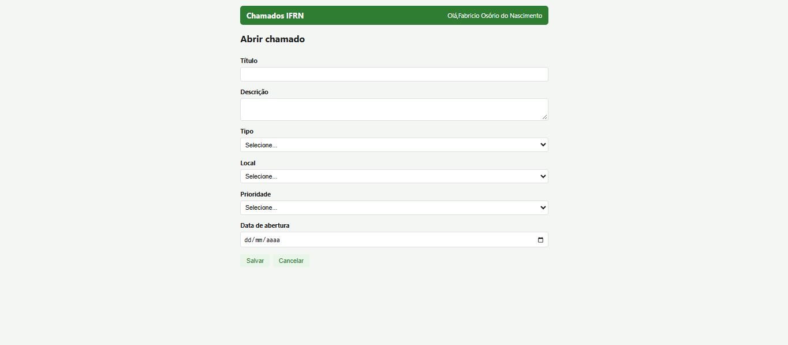
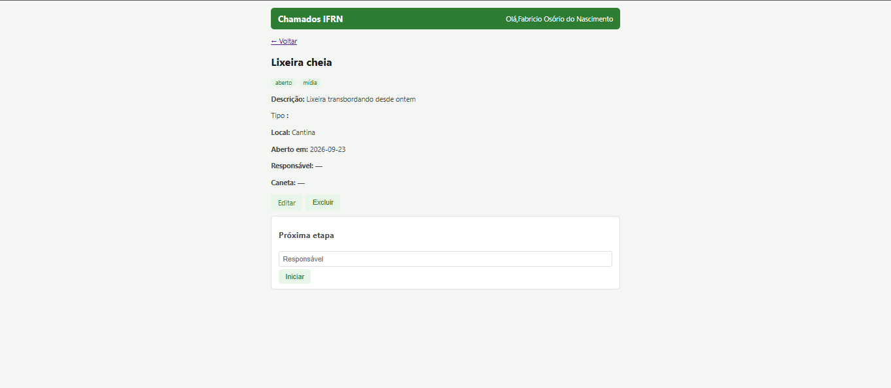

# Chamados IFRN

Front-end do Sistema de Chamados de Manutenção do IFRN (React + Vite).


## Como baixar e rodar

1. Clone o repositório:
```bash
git clone https://github.com/SEU-USUARIO/chamados-front.git
cd chamados-front
```

2. Instale as dependências:
```bash
npm install
```

3. Crie o arquivo `.env` na raiz com a sua chave da API:
```
VITE_API_KEY=sua-chave-aqui
```

4. Rode o projeto:
```bash
npm run dev
```

5. Abra `http://localhost:5173` no navegador.

6. Prints do sistema funcionando


